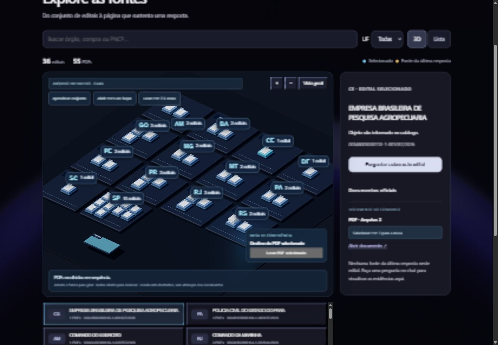

# Radar de Editais

Assistente RAG para consultar editais públicos de informática, responder em português e permitir a conferência de cada resposta no PDF original.

**Entrega local de portfólio · versão 1.0.0.** Funciona no computador de quem clona o repositório. Não há serviço hospedado nem deploy no Vercel. Resultados e limitações são apresentados separadamente das funcionalidades.



## O que faz

- Perguntas em toda a base, com descoberta do edital e esclarecimento quando há ambiguidade.
- Consulta limitada a um edital ou a até cinco PDFs escolhidos na mesa 3D.
- Busca híbrida (semântica + palavras-chave), seleção de trechos e resposta com arquivo, página e link oficial.
- Verificação literal de citações, controle de números e recusas quando falta apoio nas fontes.
- Histórico visual de conversa: cada pergunta é independente para o modelo; não há memória conversacional semântica.
- Painel para comparar versões, inspecionar casos, qualidade e corpus. Reranking adicional permanece opcional/experimental.
- Atlas 3D para explorar estados, editais e PDFs, com lista acessível alternativa.

## Experimentar em dois níveis

### 1. Painel e exploração, sem chave nem banco

Requer Node.js **22.22.2 ou superior** (verificado com 24.22.1).

```powershell
git clone https://github.com/ReneGFN/radar-de-editais.git
cd radar-de-editais/frontend
npm ci
npm run dev
```

Abra http://127.0.0.1:5173. Versões, Casos, Qualidade, Corpus e Explorar usam metadados incluídos. Perguntar exige o backend descrito abaixo. PDFs são abertos na fonte oficial, não redistribuídos.

### 2. Chatbot com documentos e respostas reais

Requer Windows, PowerShell 7, Python 3.12, Docker Desktop em execução e uma chave pessoal Groq. Downloads dependem das fontes oficiais; cada PDF é conferido por hash. O modelo/plano depende da disponibilidade da conta — não há garantia de gratuidade permanente.

Siga [Instalação e execução local](docs/execucao-local.md). Não basta executar o frontend para gerar respostas. A chave é lida só pelo backend e nunca deve entrar em `VITE_*`, Git ou captura de tela.

## Arquitetura

```text
PNCP → PDF verificado → texto por página → chunks → embeddings locais
                                                     ↓
Pergunta → descoberta/escopo → PostgreSQL + pgvector + busca textual
                             → seleção de até 5 trechos → Groq
                             → validação → resposta com fontes
```

Python/FastAPI e LangChain coordenam o núcleo. FastEmbed/MiniLM produz embeddings em CPU. React/TypeScript/Vite/Tailwind compõem a interface e Three.js o atlas. Groq executa `openai/gpt-oss-120b`. [Arquitetura detalhada](docs/arquitetura.md).

O chatbot usa o snapshot `1446c44aca18011a`: **36 contratações e 55 PDFs**, com escopo fixo de desenvolvimento. A base histórica de 30 contratações/49 PDFs é preservada nos relatórios. Não misturar resultados desses snapshots.

## Resultados e interpretação

| Evidência | Resultado | Limite |
|---|---|---|
| Variante padrão `alias_items`, desenvolvimento | 36/40 factuais e 10/10 recusas, segundo revisão humana registrada | Casos usados em ajustes; não medem generalização e não são uma taxa do chatbot atual |
| Comparação real entre dois PDFs | Garantias de 12 e 36 meses, com fontes, após correção | Um caso de desenvolvimento |
| Conferência manual recente pelo autor | Testes informados como bem-sucedidos | Não há registro caso a caso para reproduzir a contagem |
| Lote reservado de 46 casos | Relato do autor: cerca de 43 acertos, anotados em papel | Sem respostas/notas arquivadas; não publicado como precisão independente validada |

A validação formal do lote reservado permanece pendente nos arquivos do avaliador. Não há promessa de precisão mínima de 90%/95%. [Métricas históricas](docs/metricas-atuais.md) · [Erros e correções](docs/erros-e-aprendizados.md) · [Fechamento e verificações](docs/fechamento-v1.md).

## Verificar o projeto

Na raiz, após instalar as dependências Python indicadas no guia:

```powershell
& .venv/Scripts/python.exe -m pytest backend/tests -q
cd frontend
npm test
npm run build
```

Testes automatizados usam provedor simulado, sem consumo da Groq. Banco real e respostas do provedor exigem verificações separadas. [Roteiro de demonstração](docs/demonstracao.md) · [Perguntas de conferência](docs/perguntas-conferencia-estado-atual-2026-10-06.md).

## Limitações da versão

- Fontes verificáveis não garantem interpretação correta; números, itens e condições devem ser conferidos.
- Não determina vigência de edital, retificação aplicável nem habilitação de empresa.
- Extração sem OCR e interpretação heurística de tabelas/continuações.
- Contexto limitado a cinco passagens; comparações extensas podem ficar incompletas.
- Serviço local, sem autenticação multiusuário. Não expor as portas na rede.
- Sem prova de que 3D aumenta precisão; sua função é explorar e selecionar fontes.
- Base fixa e amostra de conveniência; arquivos oficiais podem mudar ou ficar indisponíveis.

Dados privados, PDFs, vetores, modelos, senhas e respostas brutas ficam fora do repositório. Fundo atual feito com CSS; a imagem externa usada no protótipo não é necessária nem distribuída. O desenvolvimento teve apoio de Codex e Kiro; definição do problema, revisões e direcionamento por Renê.
