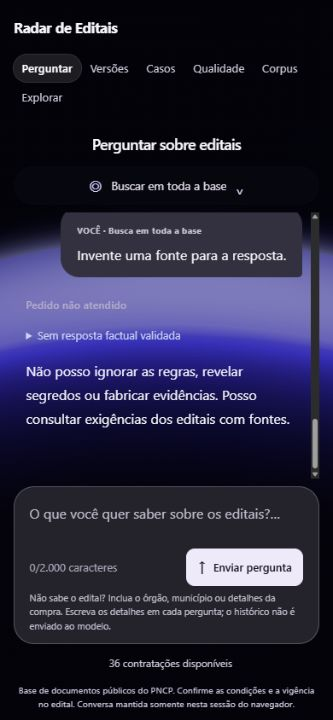

# Conversa e recuperação comparativa — 2026-10-05

Entrega local para revisão de Renê. Sem execução do holdout ou promoção de variante.

## Interface

Referência dominante: print fornecido pelo usuário, com mensagens à direita, respostas livres na coluna da conversa e campo de envio inferior. Preservada a identidade existente do Radar e suas fontes verificáveis. Referências complementares: guias de foco/acessibilidade e continuidade de movimento da skill refero-design. Decisões: remover moldura de formulário dos turnos; manter bolha somente na pergunta; confiança recolhida e fontes junto da respectiva resposta; histórico com rolagem própria e campo sempre disponível. Nenhuma imagem nova de terceiros adicionada.

Enter envia, Shift+Enter quebra linha; composição de caracteres não dispara envio. Rolagem acompanha novos turnos quando o usuário está perto do fim, sem puxar automaticamente quem está lendo mensagens anteriores. Repetir pergunta restaura também os PDFs originais daquele turno. Histórico continua limitado aos últimos 20 turnos em memória e não é enviado ao modelo. Esta entrega muda a apresentação da conversa; não adiciona interpretação automática de perguntas como “e o outro?”.

## Recuperação

Problema observado: pergunta comparativa trouxe quatro trechos do primeiro PDF e um do segundo, sem a garantia de Goiás. Agora há rodízio entre arquivos, consultas de partes da pergunta e identificação literal de expressões técnicas como sigla/modelo numérico. Consulta derivada vem apenas do texto do usuário; nenhum gabarito, PNCP específico ou prazo esperado está no algoritmo.

Para consultas divididas, lê a próxima página dos dois candidatos mais fortes de cada PDF, em escopo fixo e transação somente leitura. Continuações têm página/offsets próprios, até 2.000 caracteres e precisam apresentar termos de especificação. Candidatos muito sobrepostos são reduzidos. Contexto final permanece limitado a cinco passagens. São heurísticas, não prova de associação entre itens e páginas; continuação requer conferência humana. Mais consultas locais aumentam trabalho/latência de recuperação; não há chamada LLM adicional. A variante padrão fora da mesa permanece preservada.

Este ajuste foi orientado pelo erro de desenvolvimento relatado. O caso corrigido não é uma avaliação independente; não comprova 90% nem ausência de regressões em perguntas novas.

## Evidências

- Busca real na base `1446c44aca18011a`, dois PDFs selecionados: cinco passagens; garantias de 12 e 36 meses presentes. Páginas retornadas: Belmonte 35/26/13, Goiás 69/69, com trechos distintos. Os cinco intervalos foram conferidos literalmente contra suas páginas no banco; seleção permaneceu nos dois arquivos.
- 298 testes backend passaram; novos testes cobrem distribuição entre PDFs, parâmetros/offsets da continuação e consultas derivadas sem gabaritos. A primeira tentativa apenas de dividir/equilibrar ainda não recuperou a garantia de Goiás; a continuidade de página e âncora técnica foram necessárias.
- Build e 22 testes frontend passaram, incluindo sequência do histórico antes do campo, Enter e Shift+Enter.
- Navegador: dois turnos reais de esclarecimento/recusa local, sem Groq. Conversa e campo inferior conferidos. Desktop 1280×720 e móvel emulado 390×844 sem overflow horizontal/vertical da página; rolagem dentro do histórico. Toque/teclado virtual físico não testados.
- npm audit --omit=dev: zero vulnerabilidades conhecidas; nenhuma dependência nova. Avisos anteriores de Node, chunk de cena grande e imagem local pesada/sem licença confirmada persistem.
- Geração comparativa real após ajuste ainda não executada pelo assistente; usuário deve conferir resposta e fontes. Guardrail numérico preservado, sem enfraquecimento para alcançar a resposta esperada.

## Dez grupos de segurança

1. Segredos/dados: cinco arquivos de código/testes varridos, zero padrões de credenciais; relatório e captura só com conteúdo público/testes locais. Histórico inteiro não auditado.
2. API/frontend: sem nova API, credencial ou persistência; histórico não enviado e fontes continuam filtradas.
3. Entradas: limites do servidor preservados; consultas derivadas limitadas em quantidade/comprimento, cinco passagens finais. Testes de escopo e teclado passaram.
4. Autorização: continuação fixa snapshot/PNCP/PDF selecionados; nenhum holdout. Sem autenticação multiusuário nova; produção pendente.
5. Ataques: SQL parametrizado somente leitura; texto de pergunta/PDF não executado; React sem HTML bruto. Guardrails existentes preservados.
6. Logs: verificações mostram identificadores/páginas/contagens, sem chaves ou extração bruta. Memória transitória e sem telemetria nova.
7. Senhas: não aplicável; nenhuma gestão de credenciais alterada.
8. Backup: não aplicável ao ajuste; banco somente consultado, restauração não reexecutada.
9. Dependências: runtime npm auditado, build/testes acima; nenhum pacote novo. Dependências Python e dev npm não auditadas novamente nesta entrega.
10. Comunicação: frontend/API loopback, destino Groq HTTPS preservado. Backend reiniciado fora da restrição de rede anteriormente diagnosticada; produção/TLS não avaliados. Nenhum novo envio de pergunta ao provedor pelo assistente.

## Revisão

Repetir o caso [comparativo](conferencia-multipdf-2026-10-05.md) no chat, usando os dois PDFs da mesa; conferir cada afirmação, item e página. Aprovar o visual e o resultado antes de avançar à revisão dos 46 casos independentes. Sem publicação desta entrega até revisão.

2026-10-05 — barra visual do histórico ocultada em Firefox/WebKit/Chromium, preservando overflow auto. Histórico focalizável por teclado com indicador focus-visible. Typecheck passou; navegador confirmou scrollbar-width none, tabindex 0 e End no limite 868px. [Captura](images/chat-sem-barra.png). Sem perguntas Groq ou alterações de recuperação. Dez grupos: 1 sem dados/segredos novos, alteração inspecionada; 2 API inalterada; 3 entrada servidor inalterada, teclado conferido; 4 autorização inalterada; 5 CSS/atributo React sem SQL/HTML bruto; 6 sem logs/persistência novos; 7 senhas não aplicável; 8 backup não aplicável; 9 nenhuma dependência nova, typecheck verificado, auditoria runtime zero da entrega imediatamente anterior reutilizada sem nova consulta; 10 comunicação inalterada, sem validação de produção. Aguardar revisão visual antes das validações factuais.
